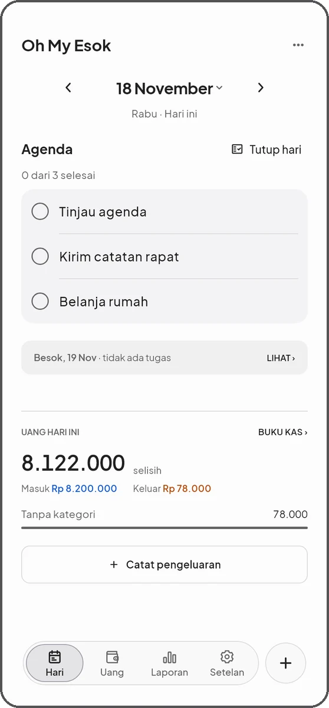
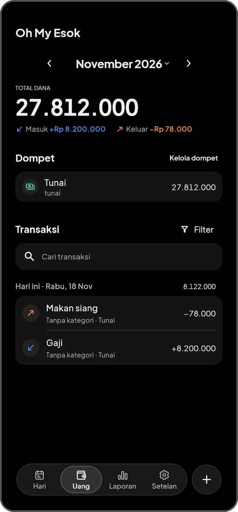
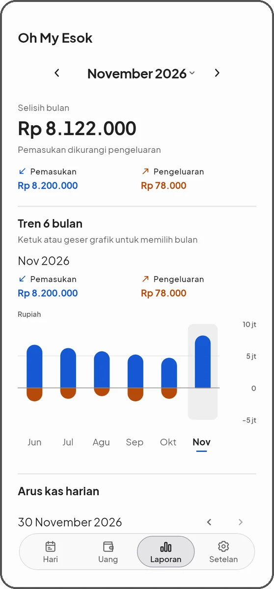

<p align="center">
  
</p>

<h1 align="center">Oh My Esok</h1>

<p align="center"><strong>Agenda berulang, catatan harian, dan buku kas dalam satu aplikasi Android.</strong></p>

<p align="center">
  <a href="https://github.com/fata69/oh-my-esok/releases"></a>
  <a href="#pasang-di-android"></a>
</p>

<p align="center">
  <a href="#fitur">Fitur</a> · <a href="#pasang-di-android">Cara pasang</a> · <a href="#build-dari-kode-sumber">Kode sumber</a>
</p>

<p align="center">
  <a href="docs/images/hari.webp"></a>
  <a href="docs/images/uang.webp"></a>
  <a href="docs/images/laporan.webp"></a>
  <br><sub>Hari · Uang · Laporan pada rilis preview. Data pada gambar adalah contoh.</sub>
</p>

## Fitur

| Bagian | Yang bisa dilakukan |
| --- | --- |
| **Hari dan pengingat** | Catat agenda per tanggal. Atur pengulangan harian, Senin–Jumat, mingguan, atau hari pilihan. Centang agenda hari ini langsung dari widget. |
| **Uang** | Catat pemasukan, pengeluaran, dan transfer. Kelola beberapa dompet dan cari transaksi lama berdasarkan catatan, kategori, atau dompet. |
| **Laporan** | Bandingkan pemasukan dan pengeluaran enam bulan, lalu buka rincian pengeluaran per kategori. |
| **Pindai struk** | Pindai struk dengan Gemini dan API key sendiri. Tinjau hasilnya sebagai draf, lalu tekan **Simpan** saat sudah benar. |
| **Cadangan data** | Ekspor atau impor JSON. Agenda dan transaksi tersimpan di perangkat tanpa akun. |

## Pasang di Android

1. Buka [GitHub Releases](https://github.com/fata69/oh-my-esok/releases) dan pilih rilis preview terbaru. Butuh Android 7.0 (API 24) atau lebih baru.
2. Pilih APK sesuai arsitektur perangkat. Kalau ragu, unduh `oh-my-esok-universal.apk`.
3. Buka APK dan ikuti konfirmasi pemasangan Android.

Sudah terpasang? Buka **Setelan → Pembaruan aplikasi → Cek pembaruan**. Aktifkan
**Sertakan prarilis** untuk menerima build preview. Mulai build 25, pilihan ini
tersimpan dan aplikasi otomatis memilih APK yang cocok dengan perangkat.

Oh My Esok bisa dipasang berdampingan dengan Esok. Untuk memindahkan data,
ekspor JSON dari Esok lalu buka **Setelan → Data → Impor** di Oh My Esok.

## Build dari kode sumber

Setiap [tag rilis](https://github.com/fata69/oh-my-esok/tags) menunjuk ke kode sumber APK
yang dipublikasikan. Checkout tag tersebut jika ingin membangun versi yang sama.

```sh
flutter pub get --enforce-lockfile
flutter analyze
flutter test
flutter build apk --debug
```

Lihat [panduan rilis](docs/RELEASING.md) untuk APK bertanda tangan dan
[panduan OTA](docs/ota.md) untuk format aset pembaruan.

## Kredit

Oh My Esok dikembangkan dan dikelola oleh [Fata (@fata69)](https://github.com/fata69).
Proyek ini adalah fork dari [Esok](https://github.com/notSeraphimXD/esok), karya
**notSeraphimXD**, dengan riwayat Git proyek asal tetap dipertahankan.
Plus Jakarta Sans disertakan dengan [SIL Open Font License](assets/fonts/plus-jakarta-sans/OFL.txt).
